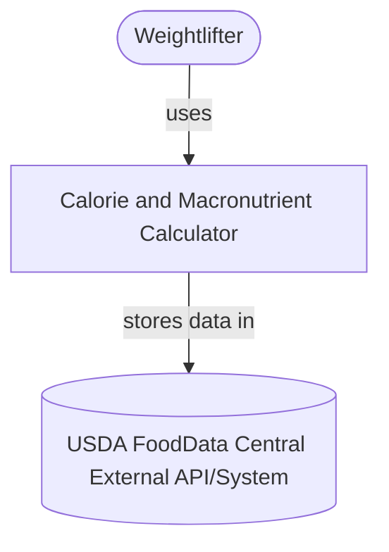
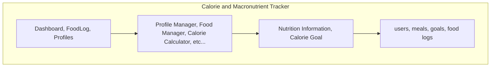
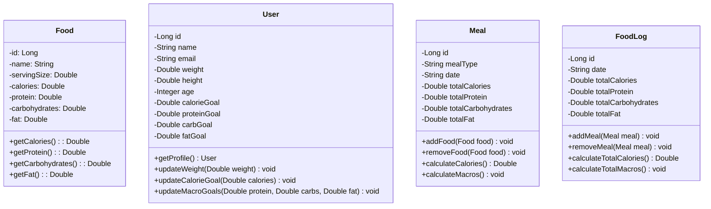
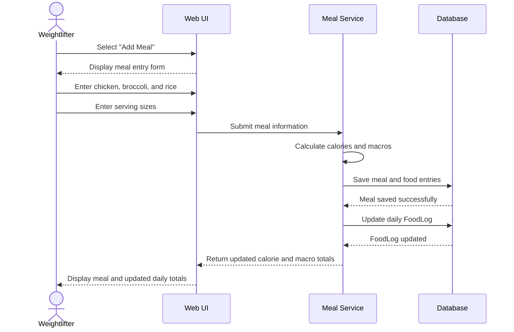

# [Calorie & Macronutrient Tracker]

<!-- CI badge: after Session 4, replace ORG/REPO and the workflow filename, then uncomment:

-->

**Student:** [Ethan Shim] · **Course:** CEN 5064 Software Design, Fall 2026 · **Partner:** [@Archacez]

## Project (approval paragraph — write this by Sun Aug 30)

Hello, my project is called MacroFood, this is a calorie tracking app that will allow users to seamlessly track calories and 
will also provide them with caloric guidance relating to their goals. This project is for users who want to be successful in 
their fitness goals: maintain/lose/gain weight etc. Core features will be personalized calorie recommendations, the ability
to search their food with the integration of USDA FoodData Central and input portion sizes. The app will automatically edit the 
macronutrients to the entered portions. Users will also be allowed to enter their own personal foods and creations for custom dishes. 
This project will be made with python for the backend and the interface and SQL for the food database. 

[One paragraph: What is the system? Who is it for? What are its 3–4 core features?
This paragraph is your approval request — see the Project Brief, Section 2.]

## How to run

# Calorie and Macronutrient Tracker

## Project Description

The Calorie and Macronutrient Tracker is a Python-based application that allows users to search for foods using the USDA FoodData Central database and calculate nutritional information based on the quantity of food consumed.

Users can search for a food, select an item from a list of USDA search results, enter the food's weight in grams, and view the corresponding calories, protein, carbohydrates, and fats.

## Requirements

Before running the application, make sure you have:

- Python 3.11 or newer (developed using Python 3.11.9)
- An internet connection
- A USDA FoodData Central API key
- The required Python libraries installed

## Installation and Setup

### Step 1: Download the Project

Clone the GitHub repository using:

```bash
git clone <repository-url>
```

Navigate into the project directory:

```bash
cd <repository-folder>
```

Alternatively, download the repository as a ZIP file, extract it, and open the extracted folder in VS Code.

### Step 2: Install Dependencies

Open a terminal in the project's root directory and run:

```bash
python -m pip install requests python-dotenv argon2-cffi
```

These libraries provide:

- **requests:** Connects the application to the USDA FoodData Central API.
- **python-dotenv:** Loads environment variables from the `.env` file.
- **argon2-cffi:** Supports secure password hashing for the authentication functionality.

If the project includes a `requirements.txt` file, you can instead install dependencies using:

```bash
python -m pip install -r requirements.txt
```

### Step 3: Configure the USDA API Key

The application requires a USDA FoodData Central API key to retrieve nutritional information.

1. Visit https://fdc.nal.usda.gov/api-key-signup
2. Request a free API key.
3. In the project's root directory, create a file named `.env`.
4. Add the following line:

```env
USDA_API_KEY=your_api_key_here
```

Replace `your_api_key_here` with your actual API key.

**Important:** Do not upload your `.env` file to GitHub. Add `.env` to your `.gitignore` file.

### Step 4: Run the Application

Open your terminal in the directory containing `main.py` and run:

```bash
python main.py
```

The application will start in the terminal.

## How to Use the Application

### 1. Search for a Food

When prompted, enter the name of a food you want to search for.

Example:

```text
Enter a food name (or 'quit'): banana
```

### 2. Select a Food

The application displays a numbered list of matching foods from the USDA database.

Example:

```text
Search Results:
--------------------------------
1. Bananas, raw
2. Bananas, dehydrated
3. Bananas, ripe, raw

Select a food number (or 0 to cancel): 1
```

Enter the number corresponding to the food you want.

### 3. Enter the Quantity

After selecting a food, enter the quantity in grams.

Example:

```text
Selected: Bananas, raw
Enter quantity in grams: 150
```

### 4. View Nutritional Information

The application calculates the calories and macronutrients based on the selected weight.

Example output (illustrative values):

```text
================================
         NUTRITION FACTS
================================
Food: Bananas, raw
Quantity: 150 g
--------------------------------
Calories:      133.50 kcal
Protein:         1.64 g
Carbohydrates:  34.26 g
Fats:            0.50 g
================================
```

Users can continue searching for additional foods or type `quit` to exit the application.

## Running Unit Tests

The project uses Python's built-in `unittest` framework.

To run all available unit tests, execute:

```bash
python -m unittest discover -s tests -v
```

To run only the macro calculation tests:

```bash
python -m unittest discover -s tests -p "test_macro_calculations.py" -v
```

Tests verify calorie calculations, protein, carbohydrate and fat calculations, nutrient formatting, and handling of missing nutritional data.

## Troubleshooting

**Error: `ModuleNotFoundError: No module named 'dotenv'`**

Install the missing dependency:

```bash
python -m pip install python-dotenv
```

**Error: `USDA_API_KEY is not configured`**

Make sure your `.env` file is located in the project's root directory and contains a valid USDA API key.

**Error: `ModuleNotFoundError: No module named 'service'`**

Make sure you are running `python main.py` from the project's root directory.

**Error: `Ran 0 tests`**

Check that the test files are saved inside the `tests/` directory, that test methods begin with `test_`, and that the test classes inherit from `unittest.TestCase`.

## Technologies Used

- Python 3.11.9
- USDA FoodData Central API
- Requests
- Python-dotenv
- SQLite (for food and user data persistence)
- Argon2 (for password hashing)
- Unittest (for automated testing)

## Future Improvements

Planned features include saving selected foods to a daily food log, tracking daily calorie and macronutrient totals, and integrating user accounts with stored food history.

## Architecture

### Tier breakdown (Session 2 studio)

| Tier | Responsibilities in THIS system |
|------|--------------------------------|
| Presentation | [what your UI layer does] totalView shows overview of all food item and. foodView shows individual food item: calories and macronutrients. AddNewFood collects new food items from user and allows them to manually enter custom calories and macronutrients.  addWeight, allows user to add their current weight and input their goal weight.  |
| Service | [what your use-case/orchestration layer does] addFood, editCalories, editWeight, editFood, editProtein, editCarbs, editFats |
| Domain | [your entities and business rules]  Food (must have at least one serving), userFood(must have at least , dailyCalories, recommendedCalories, userWeight (must have a weight of at least 1) |
| Data | [how and where data is stored] foods, calories, macronutrients, and weights data will be stored in an SQL database |

### C4 — Context & Container (Session 3 studio)





### UML — Class & Sequence (Session 3 studio)





## Architecture Decision Records

Decisions live in [`docs/adr/`](docs/adr/). Start with ADR-001 in Session 4.

| # | Decision | Status |
|---|----------|--------|
| [001](docs/adr/adr-001.md) | [What I am building and why] | [proposed] |
| [001](docs/adr/adr-0002-calculate-macros.md) | Add ADR for calculating macronutrients by weight | [completed] |

Working on adding log in page to the nutrition tracker
Finished ability to add food and macronutrients and store in database
Added ability to search for food and enter weight to see calories and macronutrients
Created presentation folder and created food_menu.py inside of it 

## Weekly log (optional but recommended)

A one-line note per week keeps your commit story readable:

- Week 1 (Aug 24): repo created, three ideas drafted
- Week 2 (Aug 31): ...
