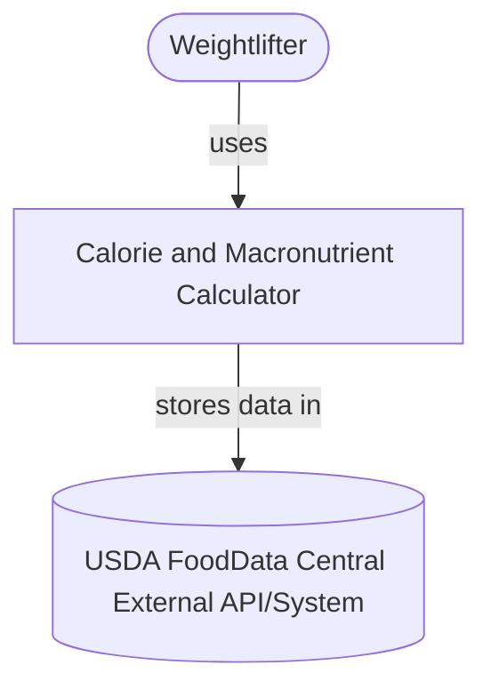
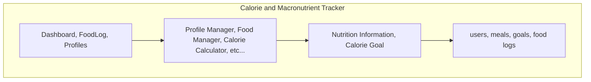
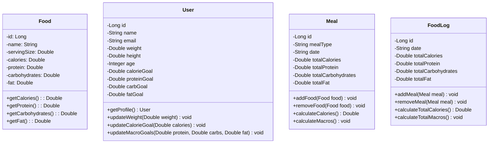
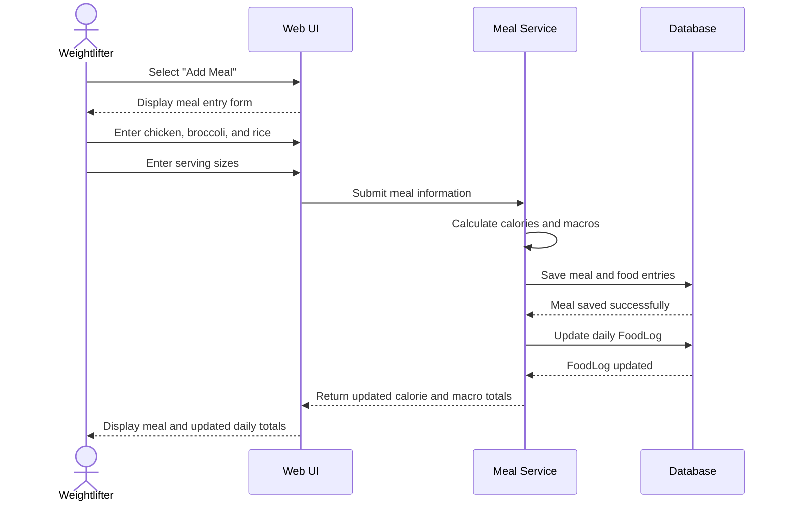

## How to Run

### Calorie and Macronutrient Tracker

The Calorie and Macronutrient Tracker is a Python application that allows users to create accounts, search for foods using USDA FoodData Central, calculate nutritional information based on weight, and maintain a daily food log.

The application includes a Tkinter graphical user interface, SQLite database storage, and a Matplotlib pie chart displaying daily macronutrient percentages.

### Requirements

Before running the application, make sure you have:

- Python 3.11 or newer (developed using Python 3.11.9)
- Windows 10/11 or macOS
- An internet connection for USDA food searches
- A USDA FoodData Central API key
- The required Python dependencies
- Tkinter support

### Installation and Setup

#### Step 1: Download the Project

Clone the GitHub repository:

```bash
git clone <repository-url>
```

Navigate to the application directory:

**Windows (PowerShell):**

```powershell
cd <repository-folder>
cd "calorie app"
```

**macOS (Terminal):**

```bash
cd <repository-folder>
cd "calorie app"
```

Alternatively, download the repository as a ZIP file, extract it, and open the `calorie app` folder in your preferred IDE.

#### Step 2: Install Python

**Windows:**

Download Python from https://www.python.org/downloads/

During installation, ensure Python is available from your terminal.

Verify the installation:

```powershell
python --version
```

**macOS:**

Download Python from https://www.python.org/downloads/macos/

Alternatively, install Python using Homebrew:

```bash
brew install python
```

Verify the installation:

```bash
python3 --version
```

On macOS, use `python3` instead of `python` for the commands below.

#### Step 3: Create a Virtual Environment (Recommended)

A virtual environment keeps the project's dependencies separate from other Python installations.

**Windows (PowerShell):**

```powershell
python -m venv .venv
.\.venv\Scripts\Activate.ps1
```

**macOS (Terminal):**

```bash
python3 -m venv .venv
source .venv/bin/activate
```

Once activated, the terminal should display `(.venv)` before the command prompt.

#### Step 4: Install Dependencies

With the virtual environment activated, run the following command on either operating system:

```bash
python -m pip install -r requirements.txt
```

The `requirements.txt` file should include:

```text
requests
python-dotenv
argon2-cffi
matplotlib>=3.8,<4
```

**Dependency explanations:**

- **requests:** Connects the application to the USDA FoodData Central API.
- **python-dotenv:** Loads the USDA API key from a `.env` file.
- **argon2-cffi:** Provides secure password hashing and verification for account registration and login.
- **matplotlib:** Creates the daily macronutrient pie chart.
- **sqlite3:** Stores user accounts and daily food logs. Included with Python.
- **tkinter:** Provides the graphical user interface.

**macOS note:** If Tkinter is missing, verify its installation using:

```bash
python3 -m tkinter
```

This should open a small test window.

For Homebrew Python, you may need the matching Tkinter package. For example, if you use Homebrew Python 3.13:

```bash
brew install python-tk@3.13
```

Use the package version that matches your installed Homebrew Python version. Python installers from python.org generally include Tkinter.

#### Step 5: Configure the USDA API Key

The application requires a USDA FoodData Central API key to search for foods and retrieve nutritional information.

1. Visit https://fdc.nal.usda.gov/api-key-signup
2. Request a free API key.
3. Create a `.env` file inside the `calorie app` directory.
4. Add the following line:

```env
USDA_API_KEY=your_api_key_here
```

Replace `your_api_key_here` with your actual USDA API key.

**Alternative: Set the API key using the terminal**

Windows (PowerShell):

```powershell
$env:USDA_API_KEY="YOUR_API_KEY_HERE"
```

macOS (Terminal):

```bash
export USDA_API_KEY="YOUR_API_KEY_HERE"
```

These commands set the environment variable for the current terminal session.

**Important:** Do not upload your `.env` file to GitHub. Make sure `.env` is included in `.gitignore`.

#### Step 6: Run the Application

Make sure your terminal is inside the `calorie app` directory containing `main.py`.

**Windows:**

```powershell
python main.py
```

**macOS:**

With the virtual environment activated:

```bash
python main.py
```

Without a virtual environment, using the appropriate Python installation:

```bash
python3 main.py
```

The Tkinter graphical user interface will open, starting with the login and account registration screen.

The application uses SQLite for database storage. The database and required tables should be initialized automatically by the repository classes when the application starts.

### How to Use the Application

**1. Create an Account or Log In**

When the application opens, users can create a new account or log into an existing account using their credentials. Passwords are securely hashed using Argon2.

**2. Search for Foods**

After logging in, users can search the USDA FoodData Central database by entering a food name.

**3. Calculate Nutritional Information**

Select a food from the search results and enter its weight in grams. The application calculates the corresponding calories, protein, carbohydrates, and fats.

**4. Add Foods to the Daily Food Log**

Users can add searched foods to their daily food log. The application stores each entry and updates daily calorie and macronutrient totals.

**5. Add Custom Foods**

Users can manually enter their own foods, including calories, protein, carbohydrates, and fats.

**6. View Macronutrient Percentages**

The application displays a pie chart showing the percentage of calculated macronutrient calories from protein, carbohydrates, and fats.

The chart uses the following conversions:

- Protein: 4 calories per gram
- Carbohydrates: 4 calories per gram
- Fats: 9 calories per gram

**7. Remove Foods and Log Out**

Users can remove food entries from their daily log and log out to return to the login screen.

### Running Unit Tests

The project uses Python's built-in `unittest` framework.

To run all unit tests on Windows or macOS with the virtual environment activated:

```bash
python -m unittest discover -s tests -p "test_*.py" -v
```

To run only the GUI tests:

```bash
python -m unittest discover -s tests -p "test_gui.py" -v
```

To run only the macronutrient pie chart tests:

```bash
python -m unittest discover -s tests -p "test_macro_chart.py" -v
```

To run only the macronutrient calculation tests:

```bash
python -m unittest discover -s tests -p "test_macro_calculations.py" -v
```

On macOS without an activated virtual environment, substitute `python3` for `python`.

### Troubleshooting

**Error: `ModuleNotFoundError: No module named 'argon2'`**

```bash
python -m pip install argon2-cffi
```

**Error: `ModuleNotFoundError: No module named 'dotenv'`**

```bash
python -m pip install python-dotenv
```

**Error: `ModuleNotFoundError: No module named 'matplotlib'`**

```bash
python -m pip install matplotlib
```

**Error: `ModuleNotFoundError: No module named 'tkinter'`**

On Windows, repair or reinstall Python with Tcl/Tk support.

On macOS, use a Python distribution that includes Tkinter or install the matching `python-tk` package for your Homebrew Python version.

**Error: `USDA_API_KEY is not configured`**

Verify that your `.env` file contains a valid USDA API key and that the application loads it using `python-dotenv`.

**Error: `ModuleNotFoundError: No module named 'presentation'`**

Make sure you are running `python main.py` from the `calorie app` directory.

**Error: `Ran 0 tests`**

Verify that your test files are located in the `tests/` directory, that filenames begin with `test_`, and that test classes inherit from `unittest.TestCase`.

### Technologies Used

- Python 3.11+
- Tkinter (graphical user interface)
- USDA FoodData Central API
- Requests (API communication)
- Python-dotenv (environment configuration)
- Argon2 (password hashing)
- SQLite (database persistence)
- Matplotlib (macronutrient percentage visualization)
- Unittest (automated testing)

### Supported Operating Systems

The application is designed to run on Windows and macOS using Python. Both operating systems use the same application code, with differences primarily in Python installation, virtual environment activation, and terminal commands.

## Architecture

### Tier breakdown (Session 2 studio)

| Tier | Responsibilities in THIS system |
|------|--------------------------------|
| Presentation | [what your UI layer does] totalView shows overview of all food item and. foodView shows individual food item: calories and macronutrients. AddNewFood collects new food items from user and allows them to manually enter custom calories and macronutrients.  addWeight, allows user to add their current weight and input their goal weight.  |
| Service | [what your use-case/orchestration layer does] addFood, editCalories, editWeight, editFood, editProtein, editCarbs, editFats |
| Domain | [your entities and business rules]  Food (must have at least one serving), userFood(must have at least , dailyCalories, recommendedCalories, userWeight (must have a weight of at least 1) |
| Data | [how and where data is stored] foods, calories, macronutrients, and weights data will be stored in an SQL database |

### C4 — Context & Container (Session 3 studio)





### UML — Class & Sequence (Session 3 studio)





## Architecture Decision Records

Decisions live in [`docs/adr/`](docs/adr/). Start with ADR-001 in Session 4.

| # | Decision | Status |
|---|----------|--------|
| [001](docs/adr/0001-Add-Food-Controller.md) | We will implement an AddFoodController that communicates with the FoodService to validate and process manually entered food information. | COMPLETED |
| [002](docs/adr/0002-calculate-macros.md) | calculates macronutrients by weight | COMPLETED |
| [003](docs/adr/0003-Add-Foods_To_Log.md) | Users can now add seached foods to their food logs | COMPLETED |
| [004](docs/adr/0004-Add-Custom-Food.md) | Users can now add their own custom food to their food logs | COMPLETED |
| [005](docs/adr/0005-Add-Login-Gui.md) | Added Login and account creation page in the GUI | COMPLETED |
| [006](docs/adr/0006-Add-UI-Visuals.md) | Added Pie Chart to see macronutrient breakdown | COMPLETED |


Working on adding log in page to the nutrition tracker
Finished ability to add food and macronutrients and store in database
Added ability to search for food and enter weight to see calories and macronutrients
Created presentation folder and created food_menu.py inside of it 
Allowed users to search for food and add it to their food log
Users can now import their own foods and macronutrients
Users can now login and create accounts 

## Weekly log (optional but recommended)

A one-line note per week keeps your commit story readable:

- Week 1 (Aug 24): repo created, three ideas drafted
- Week 2 (Aug 31): ...
